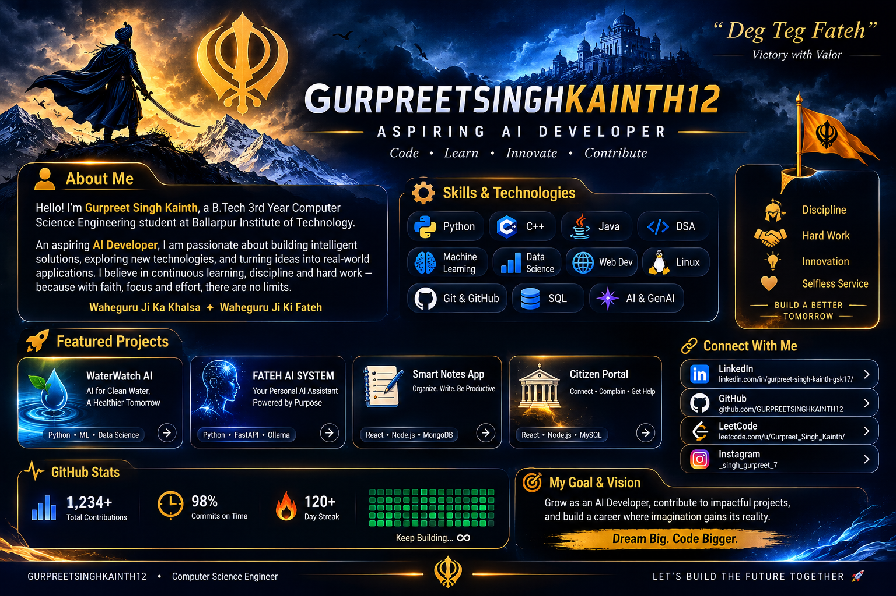

 

  
  
  

### `CODE  •  LEARN  •  BUILD  •  INNOVATE`

*“Where imagination gains its reality.”*

---

## ⚔️ About Me

Hey! I'm **Gurpreet Singh Kainth**, a B.Tech third-year **Computer Science and Engineering student**, with a minor in **Electronics & Telecommunication**, at **Ballarpur Institute of Technology**.

I'm an aspiring AI developer who enjoys exploring intelligent systems, writing code, solving problems, and turning ideas into practical applications. I'm continuously strengthening my fundamentals while learning how modern AI can make software more useful.

- 🤖 Exploring **Artificial Intelligence, Machine Learning, and GenAI**
- 🧠 Building my foundations in **DSA and core computer science**
- 🛠️ Developing **FATEH AI SYSTEM**, a personal AI assistant
- 🐧 Working with **Linux, Python, and developer tools**
- 🌱 Learning by building, testing, breaking, and improving

> **My approach:** Stay curious. Work with discipline. Build with purpose.

## 🧭 The values behind the code

The Khalsa-inspired symbols in my banner are a personal visual tribute to values I aim to carry into my work:

**Courage · Discipline · Integrity · Selfless Service · Continuous Learning**

*Deg Teg Fateh* reminds me of the responsibility to pair courage with compassion and service.

---

## 🧰 Technologies & Tools

### Programming

### Development & Tools

**Currently exploring:** AI/ML · Generative AI · FastAPI · Ollama · Voice interfaces

*These represent technologies I've studied, used, or am actively exploring. I'm always expanding this toolkit.*

---

## 🚀 Featured Project

<table>
<tr>
<td width="100%">

### 🧠 FATEH AI SYSTEM
**A personal AI assistant, built with purpose.**

I'm developing FATEH as a local-first, voice-enabled AI assistant. The current work includes connecting a local language model to a FastAPI backend, maintaining conversation history, and building speech input/output capabilities.

**Current development stack**
- Python · FastAPI
- Ollama · Qwen
- SQLite
- Piper text-to-speech
- WSL2 / Linux development environment

</td>
</tr>
</table>

More projects and build notes will be added here as they become ready to showcase.

---

## 📊 GitHub Analytics

 

 

 

---

## 🐍 Contribution Journey

<!-- This animation is generated by the GitHub Actions workflow included in this repository. -->

---

## 🤝 Connect With Me

  

### ✨ Dream Big. Code Bigger.

**Waheguru Ji Ka Khalsa · Waheguru Ji Ki Fateh**

